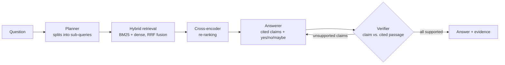

# BioRAG: Agentic RAG for Biomedical Literature

[](https://github.com/SamhithaVedaraju/biomed-agentic-rag/actions/workflows/ci.yml)

BioRAG answers biomedical research questions from PubMed abstracts. Every claim it makes cites the passage that supports it, and a separate verifier model checks each claim before the answer is returned.

It also includes an evaluation harness that measures how much each part helps. It compares a closed-book LLM, naive RAG and the full agentic pipeline on **PubMedQA** and **BioASQ**, scoring accuracy, retrieval quality and claim-level hallucination rate.

## Architecture



| Stage | What it does | Implementation |
|---|---|---|
| Planner | Splits a question into focused search queries (population, intervention, outcome) | Claude, JSON-schema output |
| Sparse retrieval | Exact matching of drug names, genes and acronyms | BM25 (`rank-bm25`) with a hyphen-aware tokenizer (`IL-6`, `COVID-19`) |
| Dense retrieval | Matches meaning ("heart attack" ≈ "myocardial infarction") | `BAAI/bge-*` embeddings in Qdrant (embedded mode, no server) |
| Fusion | Merges both rankings without score calibration | Reciprocal Rank Fusion |
| Re-ranking | Rescores the top 30 candidates by reading the query and passage together | Cross-encoder |
| Answerer | Writes an answer using only the evidence, with numbered citations | Claude |
| Verifier | Checks each claim against the passages it cites, and sends unsupported claims back for one revision | Claude Haiku (separate, cheaper judge) |
| Orchestration | Typed state graph with a conditional revision loop | LangGraph |

## Results

> Every number in this section comes from a script in this repo, and the run's per-question records are saved in `artifacts/results/`. Run the commands under [Reproduce](#reproduce) to check them yourself.

### End-to-end (PubMedQA, labeled split)

*Pending first run.*

| System | Accuracy | Answers with ≥1 hallucination | Unsupported claims / 100 | Recall@5 | nDCG@10 |
|---|---|---|---|---|---|
| Closed-book LLM | | | | — | — |
| Naive RAG | | | | | |
| Agentic RAG (this repo) | | | | | |

### Retrieval ablation (no LLM calls)

*Pending first run.*

| Retriever | Recall@5 | MRR@10 | nDCG@10 | p50 latency |
|---|---|---|---|---|
| BM25 | | | | |
| Dense | | | | |
| Hybrid (RRF) | | | | |
| Hybrid + re-rank | | | | |

### How the metrics are defined

- **Accuracy:** the predicted yes/no/maybe matches the gold label. Errors and refusals count as wrong.
- **Hallucination:** a judge model checks every claim. RAG systems are checked against the passages they cite. The closed-book baseline has nothing to cite, so its claims are checked against the gold abstract. The judge runs as a fresh call, separate from the pipeline's own verifier.
- **Retrieval:** document-level (PMID) recall, MRR and nDCG of the gold paper(s).

## Quickstart

```bash
git clone https://github.com/SamhithaVedaraju/biomed-agentic-rag && cd biomed-agentic-rag
python -m venv .venv && source .venv/bin/activate   # Windows: .venv\Scripts\activate
pip install torch --index-url https://download.pytorch.org/whl/cpu
pip install -e ".[dev,ui]"
cp .env.example .env
```

Pick an LLM backend in `.env`:

- **Ollama (free, default).** Install [Ollama](https://ollama.com), then run `ollama pull qwen2.5:3b`. Everything runs on your machine with no account or key. Small local models are slower and less accurate.
- **Claude.** Set `BIORAG_LLM_BACKEND=claude` and `ANTHROPIC_API_KEY`. This uses Claude Opus 5.5 as the generator and Claude Haiku 5.5 as the judge.

Build a corpus and index (PubMedQA needs no account):

```bash
biorag prepare-pubmedqa --distractors 9000   # 10K abstracts
biorag build-index                            # ~10 min on a laptop CPU with bge-small
```

Ask a question:

```bash
biorag ask "Does metformin reduce cancer risk in type 2 diabetes?"
```

Or start the API or the demo UI:

```bash
biorag serve                          # POST /ask  {"question": "..."}
streamlit run app/streamlit_app.py
```

## Reproduce

```bash
biorag bench-retrieval --limit 500     # free: retrieval ablation
biorag eval --limit 100                # calls the Claude API: end-to-end comparison
```

**BioASQ.** Download a Task B training file from the [participants area](https://participants-area.bioasq.org/) (it needs a free account), then:

```bash
biorag prepare-bioasq path/to/trainingXXb.json --pubmedqa-distractors 5000   # needs NCBI_EMAIL
biorag build-index
biorag eval --dataset bioasq --bioasq-path path/to/trainingXXb.json --limit 100
```

**Comparing embedding models.** Each model needs its own index:

```bash
BIORAG_EMBEDDING_MODEL=intfloat/e5-large-v2 BIORAG_DATA_DIR=data-e5 biorag build-index
BIORAG_EMBEDDING_MODEL=intfloat/e5-large-v2 BIORAG_DATA_DIR=data-e5 biorag bench-retrieval
```

**Your own topic.** Build a corpus from any PubMed search:

```bash
biorag fetch-pubmed "sglt2 inhibitors AND heart failure" --retmax 2000
```

## Project layout

```
src/biorag/
  data/        PubMedQA, BioASQ and PubMed E-utilities loaders; sentence-aware chunking
  retrieval/   BM25, dense (Qdrant), RRF fusion, cross-encoder re-ranking, index builder
  agents/      LangGraph pipeline, prompts, structured-output schemas
  eval/        metrics, end-to-end evaluation, retrieval benchmark
  llm.py       Claude wrapper: JSON-schema outputs, refusal fallbacks, token accounting
  api.py       FastAPI service
  cli.py       `biorag` command line
app/           Streamlit demo
tests/         unit tests; pipeline control flow is tested with a scripted LLM (no API calls)
```

## Limitations

- Abstracts only, no full text. Some answers depend on details found only in full papers.
- PubMedQA questions were written from their source abstracts, which makes retrieval easier than real clinical questions. BioASQ is the harder, more realistic test.
- The verifier is an LLM, so it can be wrong too. The hallucination numbers estimate grounding; they don't guarantee it.
- This is a research tool, not medical advice.

## License

MIT
