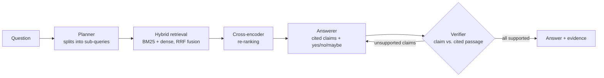

# BioRAG: Agentic RAG for Biomedical Literature

[](https://github.com/SamhithaVedaraju/biomed-agentic-rag/actions/workflows/ci.yml)

BioRAG answers biomedical research questions from PubMed abstracts. Every claim it makes cites the passage that supports it, and a separate verifier model checks each claim before the answer is returned.

It also includes an evaluation harness that measures how much each part helps. It compares a closed-book LLM, naive RAG and the full agentic pipeline on **PubMedQA** and **BioASQ**, scoring accuracy, retrieval quality and claim-level hallucination rate.

## Architecture



| Stage | What it does | Implementation |
|---|---|---|
| Planner | Splits a question into focused search queries (population, intervention, outcome) | LLM with JSON-schema output (local Qwen2.5 via Ollama, or Claude) |
| Sparse retrieval | Exact matching of drug names, genes and acronyms | BM25 (`rank-bm25`) with a hyphen-aware tokenizer (`IL-6`, `COVID-19`) |
| Dense retrieval | Matches meaning ("heart attack" ≈ "myocardial infarction") | `BAAI/bge-*` embeddings in Qdrant (embedded mode, no server) |
| Fusion | Merges both rankings without score calibration | Reciprocal Rank Fusion |
| Re-ranking | Rescores the top 30 candidates by reading the query and passage together | Cross-encoder |
| Answerer | Writes cited claims from the evidence first, then the yes/no/maybe decision | Same LLM |
| Verifier | Checks each claim against the passages it cites, and sends unsupported claims back for one revision | Judge LLM, a separate call (Claude Haiku on the Claude backend) |
| Orchestration | Typed state graph with a conditional revision loop | LangGraph |

## Results

> Every number in this section comes from a script in this repo, and the run's per-question records are saved in `artifacts/results/`. Run the commands under [Reproduce](#reproduce) to check them yourself.

### End-to-end (PubMedQA, labeled split)

Setup: first 20 questions of the labeled split, same 10,000-abstract corpus as below. Generator **and** judge: `qwen2.5:7b` running locally through Ollama (free, no API), on a laptop CPU. Raw output: [`artifacts/results/pubmedqa-20261028-024842/`](artifacts/results/pubmedqa-20261028-024842/).

| System | Accuracy | Answers with ≥1 hallucination | Unsupported claims / 100 | Recall@5 | MRR | Mean latency |
|---|---|---|---|---|---|---|
| Closed-book LLM | 0.40 | 0.95 | 48.4 | — | — | 44 s |
| Naive RAG | 0.55 | **0.15** | **13.0** | 0.95 | 0.925 | 135 s |
| Agentic RAG (this repo) | **0.60** | **0.15** | 19.4 | 0.95 | **0.950** | 272 s |

**What this shows, and what it doesn't:**

- **Retrieval is what cuts hallucination.** Grounding answers in retrieved abstracts takes the share of answers with an unsupported claim from 95% to 15%, and unsupported claims from 48 to 13–19 per 100. (The closed-book baseline is judged against the gold abstract, so general knowledge the abstract doesn't state also counts against it.)
- **The planner and verifier add little at this scale.** Agentic RAG answered one more question correctly than naive RAG and ranked the gold paper slightly higher (MRR 0.950 vs 0.925), but it wrote more claims and had a higher unsupported-claim rate. The verifier and the eval judge are the same 7B model in separate calls, and they don't always agree.
- **No system beats the majority baseline.** 13 of the 20 gold labels are "yes", so always answering "yes" scores 0.65. The agentic system answers "yes" 17 times out of 20.
- **n = 20 is small.** One question is 5 points of accuracy; treat these as a smoke test of the harness, not a benchmark result. Larger runs (and the Claude backend) are the next step.
- An earlier run with `qwen2.5:3b` answered "maybe" with no claims almost every time, because the answer schema asked for the decision before the claims. The schema now asks for claims first, and the eval reports `answers_without_claims` so empty answers can't pass as hallucination-free.

### Retrieval ablation (no LLM calls)

Setup: 500 PubMedQA questions; corpus of 10,000 abstracts (17,117 chunks) in which each question's source abstract is mixed with 9,000 distractors. Embeddings: `bge-small-en-v1.5`. Re-ranker: `ms-marco-MiniLM-L-6-v2`. Hardware: laptop CPU (i7-1355U). Raw output: [`artifacts/results/retrieval-pubmedqa-bge-small-en-v1.5.json`](artifacts/results/retrieval-pubmedqa-bge-small-en-v1.5.json).

| Retriever | Recall@5 | MRR@10 | nDCG@10 | p50 latency |
|---|---|---|---|---|
| BM25 | 0.936 | 0.878 | 0.896 | 74 ms |
| BM25 + re-rank | 0.960 | 0.942 | 0.949 | 1.9 s |
| Dense | **0.974** | **0.956** | **0.962** | 110 ms |
| Dense + re-rank | **0.976** | 0.953 | 0.959 | 2.1 s |
| Hybrid (RRF) | 0.974 | 0.932 | 0.943 | 264 ms |
| Hybrid + re-rank | 0.974 | 0.952 | 0.959 | 2.8 s |

**What this shows:**

- **Dense retrieval wins on PubMedQA.** Hybrid fusion lowers MRR from 0.956 to 0.932: BM25's weaker ranking pulls the fused list down. PubMedQA questions were written from their source abstracts, so they share vocabulary and meaning with them, which favors dense search.
- **The general-domain re-ranker helps BM25 (+0.064 MRR) but not dense retrieval,** and it costs about 2 s per query on CPU. Next experiments: a biomedical re-ranker, and the harder BioASQ questions, where exact matching of gene and drug names should give BM25 and hybrid search more to contribute.

### How the metrics are defined

- **Accuracy:** the predicted yes/no/maybe matches the gold label. Errors and refusals count as wrong.
- **Hallucination:** a judge model checks every claim. RAG systems are checked against the passages they cite. The closed-book baseline has nothing to cite, so its claims are checked against the gold abstract. The judge runs as a fresh call, separate from the pipeline's own verifier.
- **Retrieval:** document-level (PMID) recall, MRR and nDCG of the gold paper(s).

## Quickstart

```bash
git clone https://github.com/SamhithaVedaraju/biomed-agentic-rag && cd biomed-agentic-rag
python -m venv .venv && source .venv/bin/activate   # Windows: .venv\Scripts\activate
pip install torch --index-url https://download.pytorch.org/whl/cpu
pip install -e ".[dev,ui]"
cp .env.example .env
```

Pick an LLM backend in `.env`:

- **Ollama (free, default).** Install [Ollama](https://ollama.com), then run `ollama pull qwen2.5:7b`. Everything runs on your machine with no account or key. Expect several minutes per question on a laptop CPU; 3B models were too weak to follow the answer format reliably.
- **Claude.** Set `BIORAG_LLM_BACKEND=claude` and `ANTHROPIC_API_KEY`. This uses Claude Opus 5.5 as the generator and Claude Haiku 5.5 as the judge.

Build a corpus and index (PubMedQA needs no account):

```bash
biorag prepare-pubmedqa --distractors 9000   # 10K abstracts
biorag build-index                            # ~10 min on a laptop CPU with bge-small
```

Ask a question:

```bash
biorag ask "Does metformin reduce cancer risk in type 2 diabetes?"
```

Or start the API or the demo UI:

```bash
biorag serve                          # POST /ask  {"question": "..."}
streamlit run app/streamlit_app.py
```

## Reproduce

```bash
biorag bench-retrieval --limit 500     # free: retrieval ablation
biorag eval --limit 20                 # end-to-end comparison (~2.5 h locally; costs money on the Claude backend)
```

**BioASQ.** Download a Task B training file from the [participants area](https://participants-area.bioasq.org/) (it needs a free account), then:

```bash
biorag prepare-bioasq path/to/trainingXXb.json --pubmedqa-distractors 5000   # needs NCBI_EMAIL
biorag build-index
biorag eval --dataset bioasq --bioasq-path path/to/trainingXXb.json --limit 100
```

**Comparing embedding models.** Each model needs its own index:

```bash
BIORAG_EMBEDDING_MODEL=intfloat/e5-large-v2 BIORAG_DATA_DIR=data-e5 biorag build-index
BIORAG_EMBEDDING_MODEL=intfloat/e5-large-v2 BIORAG_DATA_DIR=data-e5 biorag bench-retrieval
```

**Your own topic.** Build a corpus from any PubMed search:

```bash
biorag fetch-pubmed "sglt2 inhibitors AND heart failure" --retmax 2000
```

## Project layout

```
src/biorag/
  data/        PubMedQA, BioASQ and PubMed E-utilities loaders; sentence-aware chunking
  retrieval/   BM25, dense (Qdrant), RRF fusion, cross-encoder re-ranking, index builder
  agents/      LangGraph pipeline, prompts, structured-output schemas
  eval/        metrics, end-to-end evaluation, retrieval benchmark
  llm.py       Ollama and Claude backends: JSON-schema outputs, refusal fallbacks, token accounting
  api.py       FastAPI service
  cli.py       `biorag` command line
app/           Streamlit demo
tests/         unit tests; pipeline control flow is tested with a scripted LLM (no API calls)
```

## Limitations

- Abstracts only, no full text. Some answers depend on details found only in full papers.
- PubMedQA questions were written from their source abstracts, which makes retrieval easier than real clinical questions. BioASQ is the harder, more realistic test.
- The verifier is an LLM, so it can be wrong too. The hallucination numbers estimate grounding; they don't guarantee it.
- This is a research tool, not medical advice.

## License

MIT
